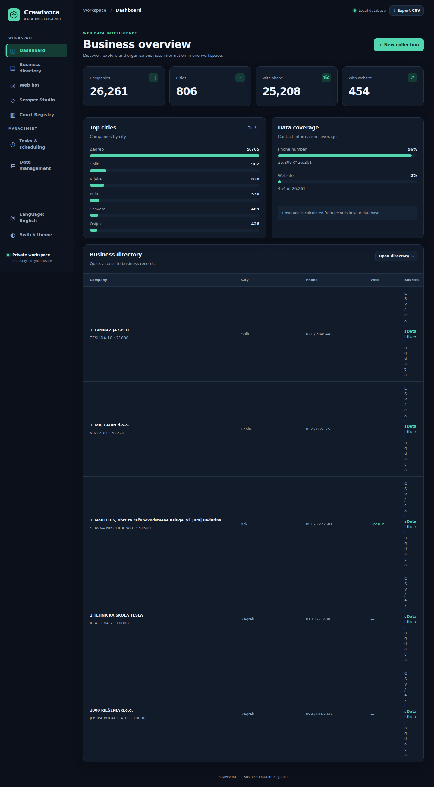
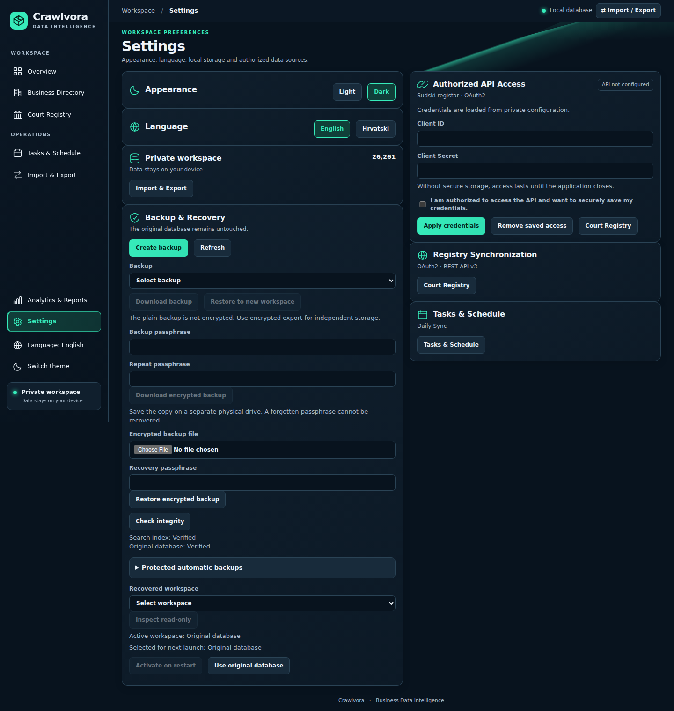

# Crawlvora

### Croatian business intelligence. One powerful desktop workspace.

Discover companies, explore official Court Registry records and turn business data into actionable information — all from a beautifully organized, local-first workspace.

**[Download Crawlvora](https://github.com/bren-wp/Crawlvore/releases)** · [Explore the workspace](#explore-the-workspace) · [Get started](#get-started)

---

## Your business data, under your control

Crawlvora brings the Croatian Court Registry and your existing company directory together in a single desktop application. Find the right business, examine its official identity, keep track of changes and export the information you need — without sending your private workspace to a cloud service.

| | |
|---|---|
| 🏢 **26,261 included directory records** | Start with the bundled directory in a fresh workspace, without having to configure an online connection first. |
| 🏛️ **Official registry integration** | Access the Croatian Court Registry public v3 API with your authorized account. |
| 🔎 **Precision search** | Find companies by name, location, OIB, MBS or indexed text. |
| 🔒 **Local-first by design** | Keep your directory, registry snapshots and working data on your device. |

## Explore the workspace

Crawlvora combines a dedicated business directory, official registry browser, task manager, analytics and data management in one consistent interface.

<!-- PRODUCT_SCREENSHOTS_START -->
Actual application interface rendered in English with controlled sample data.

| Overview | Business Directory |
|---|---|
|  |  |

| Court Registry | Tasks & Schedule |
|---|---|
|  |  |

| Import & Export | Analytics & Reports |
|---|---|
|  |  |

| Settings | Company Profile |
|---|---|
|  |  |
<!-- PRODUCT_SCREENSHOTS_END -->

### Find the information that matters

**Business directory.** Search and filter your collection, open individual company profiles and explore their available identity and contact information. Source links and preserved alternative values help you understand where information came from.

**Court Registry.** Connect directly to the official public API using authorized OAuth2 access. Synchronize available bulk categories, browse consistent snapshots, resume interrupted downloads and compare completed snapshots.

**Tasks & Schedule.** Organize synchronization jobs and schedule weekday updates while Crawlvora is running. Keep your workflow in one place.

**Analytics & Reports.** Explore your available business data through the dedicated analytics workspace, then export structured records for further analysis.

### Work with data on your terms

| Capability | What you can do |
|---|---|
| 📥 **Import** | Bring existing CSV and JSON company datasets into your directory. |
| 📤 **Export** | Save directory records as CSV, JSON or Excel. Registry category exports also support XML, JSONL and SQLite SQL. |
| 🔄 **Synchronize** | Retrieve authorized official records, with snapshot-aware pagination and resumable progress. |
| 🧩 **Consolidate** | Merge compatible business identities using OIB and MBS while preserving existing contact information and provenance. |
| 🗂️ **Explore history** | Review completed registry snapshots and locally observed changes. |

### Designed for everyday work

*The same Crawlvora workspace, in a refined light appearance.*

Choose the dark or light theme and switch between English and Croatian. A resizable desktop window and responsive layouts keep the workspace comfortable across different screen sizes.

### Keep your information protected

Crawlvora offers verified SQLite backups, encrypted backup exports, isolated recovery workspaces and operating-system-protected credential storage. Existing databases are preserved when upgrading; recovery creates a separate workspace rather than replacing the only copy.

Your authorized registry credentials can be retained through Windows DPAPI or Linux Secret Service. Once enrolled, use **Synchronize** to access the official registry without re-entering the pair on every launch.

## Get started

[**Browse available desktop releases**](https://github.com/bren-wp/Crawlvore/releases)

| Platform | Package | How to open |
|---|---|---|
| Windows 10/11 x64 | `Portable.exe` | Launch directly with Microsoft WebView2 Runtime available. |
| Windows 10/11 x64 | `Setup.exe` | Install Crawlvora and the required WebView2 runtime if missing. |
| Linux x86_64 | `Crawlvora-Linux-amd64.deb` | Install with your package manager (Ubuntu 24.04 baseline). |
| Linux x86_64 | `Crawlvora-Linux-x86_64.tar.gz` | Extract and launch Crawlvora with system runtime dependencies installed. |

The native desktop packages do not require a separate Python installation or a manually launched local server.

**Connect the Court Registry:** open Settings → API Access and enroll your authorized credentials once, unless your installation is already securely provisioned. Then open Court Registry and select Synchronize. Offline access to existing local records does not require a live API connection.

## Data and availability

The Croatian Court Registry is the sole online collection source. Crawlvora also supports your own imported CSV and JSON datasets. The official API requires valid authorization and is subject to the provider's terms, availability and applicable data-use obligations.

The included directory and a fully synchronized official snapshot are different datasets. Check the release's accompanying registry manifest, when supplied, for the exact snapshot and verified record counts. A preview without that manifest should not be assumed to contain a complete registry mirror.

Crawlvora is an independent application, not an official service of the Croatian Court Registry.

[Official registry API](https://sudreg-data.gov.hr/) · [User guide](docs/USER-GUIDE.md) · [License](LICENSE)

---

**Crawlvora — Business Data Intelligence**

Discover. Organize. Synchronize.

[Download](https://github.com/bren-wp/Crawlvore/releases) · [Support & feedback](https://github.com/bren-wp/Crawlvore/issues)

