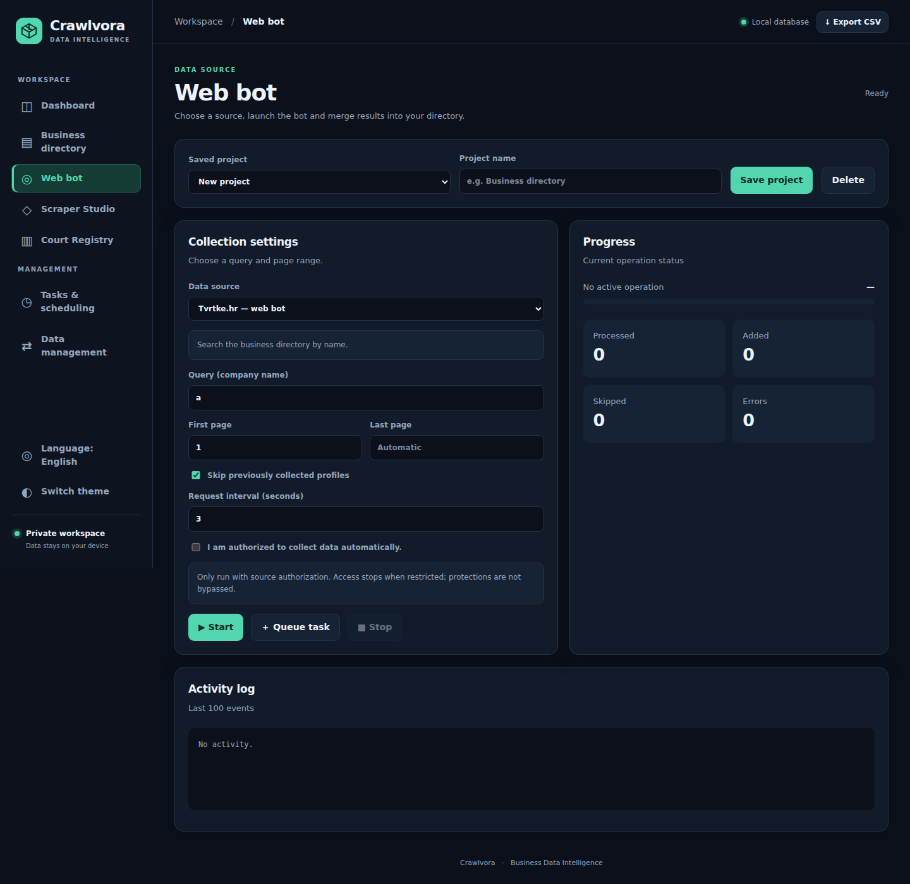
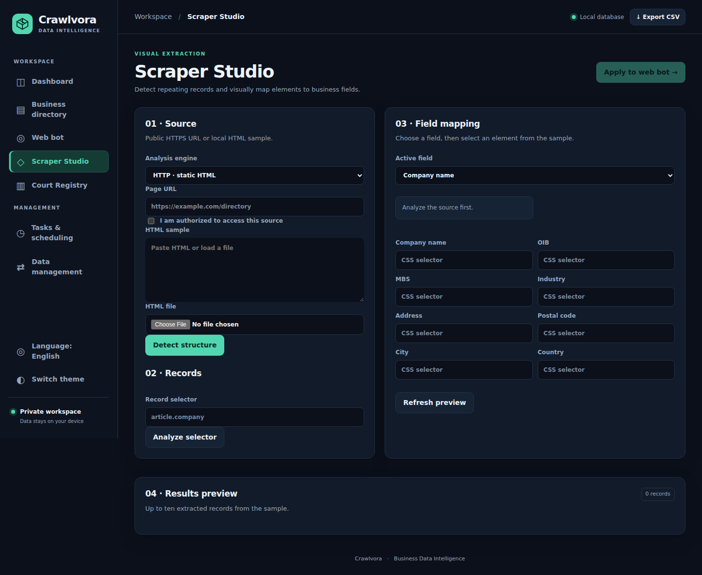
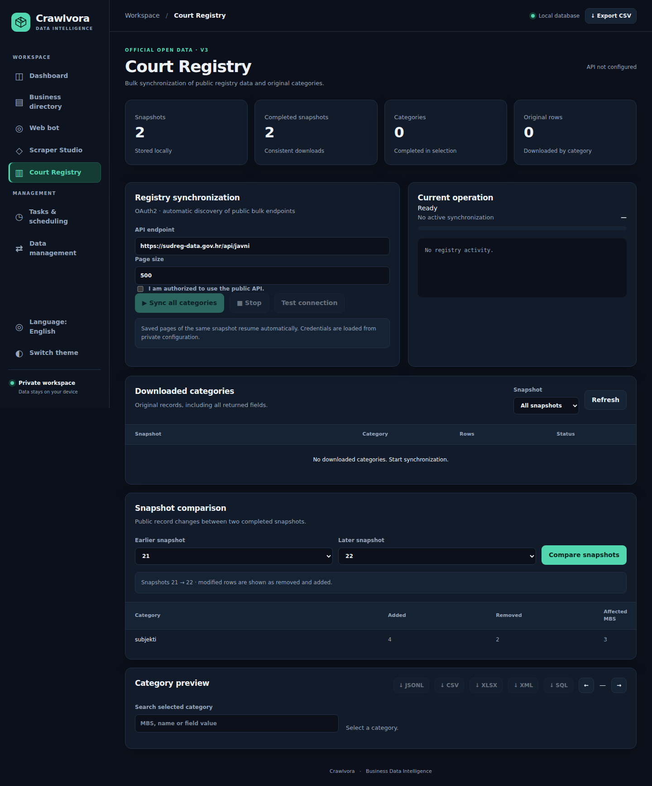
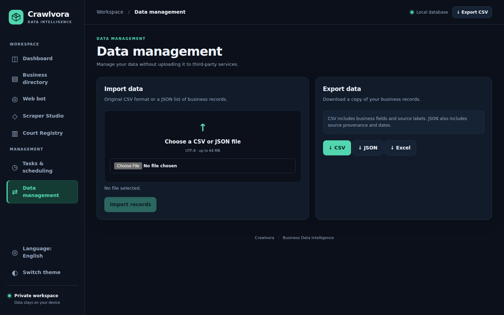

# Crawlvora

**Discover business data. Automate collection. Turn information into insight.**

[Explore features](#features) · [Screenshots](#screenshots) · [Get started](#get-started)

Crawlvora is a local-first business data intelligence workspace for collecting authorized web and API data, organizing company records and exporting structured information. From visual extraction to registry synchronization, everything is designed around a single searchable workspace.

## Features

| | |
|---|---|
| 🔎 **Intelligent discovery** | Recognize repeating HTML structures and suggest business fields, then confirm the extracted sample. |
| 🌐 **Web automation** | Collect authorized static pages with HTTP or render JavaScript pages with Playwright. |
| 🏢 **Business directory** | Search, filter and organize company records, with source provenance and locally observed changes. |
| 🏛️ **Court Registry** | Connect to the Croatian public registry API, synchronize consistent snapshots and compare completed snapshots. |
| 🗓️ **Tasks and scheduling** | Save projects, queue collection jobs and schedule weekday registry updates while the application runs. |
| 📊 **Flexible exports** | Export directory data to CSV, JSON or Excel; registry categories also support XML, JSONL and SQLite SQL. |
| 🔒 **Local-first workspace** | Keep your database on your device. Access restrictions are respected and credentials stay outside public distribution. |
| 🎨 **A unified workspace** | Obsidian and mint visual identity, light and dark themes, responsive layouts. |

## Screenshots

Actual application UI rendered with controlled sample data. Screenshots are captured from the running application interface in English, with controlled sample data. Both themes and Croatian are also supported.

| Business directory | Web bot |
|---|---|
|  |  |
| **Scraper Studio** | **Court Registry** |
|  |  |
| **Tasks & scheduling** | **Data management** |
|  |  |
| **Company profile** | **Light theme** |
|  |  |

## Data sources

| Source | Connection |
|---|---|
| Tvrtke.hr | Dedicated permission-aware web adapter |
| Croatian Court Registry | Public OAuth2 REST API |
| CompanyWall.hr / Company.hr | Configurable authorized API connections |
| Other permitted websites | HTML extraction or Playwright |
| Existing datasets | CSV and JSON import |

Third-party permissions, credentials and availability are required where applicable. No paid API access is included.

## Get started

- **Windows:** Run `START-WINDOWS.bat` with Python installed.
- **Linux:** Run `bash start-linux.sh`.
- **Desktop packages:** Check [Releases](https://github.com/bren-wp/Crawlvore/releases) for published builds. Native portable, installer and Linux packages are published only after the complete release gates pass.

For registry access, configure your own OAuth2 credentials privately. See the [user guide](docs/USER-GUIDE.md) and [verification report](AUDIT.md).

---

**Crawlvora — Business Data Intelligence**

[Releases](https://github.com/bren-wp/Crawlvore/releases) · [Issues](https://github.com/bren-wp/Crawlvore/issues) · [License](LICENSE)

