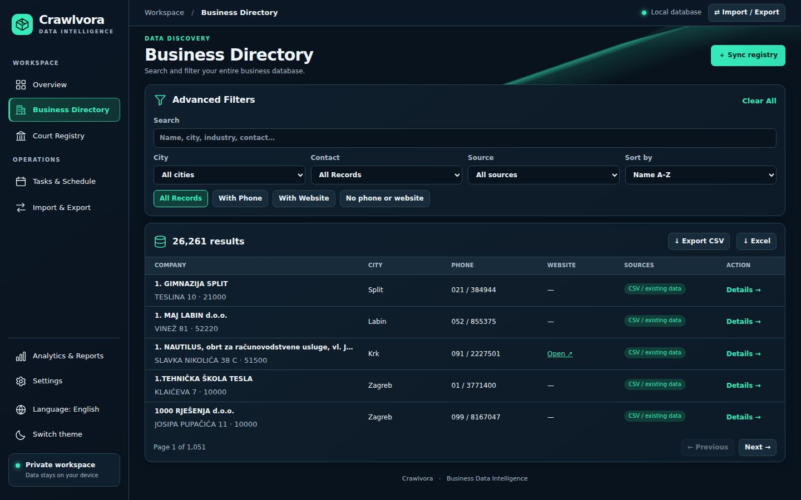

# Crawlvora

**Discover Croatian business data. Keep your registry in sync.**

[Explore features](#features) · [Screenshots](#screenshots) · [Get started](#get-started)

Crawlvora is a local-first business data intelligence workspace for the Croatian Court Registry. Synchronize official public records, enrich your existing directory with authorized data and export structured information.

## Features

| | |
|---|---|
| 🏢 **Business directory** | Search, filter and organize company records, with source provenance and locally observed changes. |
| 🏛️ **Court Registry** | Connect to the Croatian public registry API, synchronize consistent snapshots and compare completed snapshots. |
| 🗓️ **Tasks and scheduling** | Queue registry synchronization jobs and schedule weekday registry updates while the application runs. |
| 📊 **Flexible exports** | Export directory data to CSV, JSON or Excel; registry categories also support XML, JSONL and SQLite SQL. |
| 🔒 **Local-first workspace** | Verified local database backups, atomic imports and workspace locking. Keep your database on your device. Access restrictions are respected and credentials stay outside public distribution. |
| 🛡️ **Recovery and continuity** | Create verified copies, export encrypted archives and restore into a separate workspace. Optional system-protected key storage and independent-volume replication. |
| ⚡ **Indexed search** | Find businesses by name, exact OIB or MBS, or indexed text. |
| 🎨 **A unified workspace** | Obsidian and mint visual identity, light and dark themes, responsive layouts. |

## Screenshots

Crawlvora's redesigned desktop workspace includes a business overview, directory, registry, scheduler, import/export, analytics and settings.

<!-- PRODUCT_SCREENSHOTS_START -->
Actual application interface rendered in English with controlled sample data.

| Overview | Business Directory |
|---|---|
|  |  |

| Court Registry | Tasks & Schedule |
|---|---|
|  |  |

| Import & Export | Analytics & Reports |
|---|---|
|  |  |

| Settings | Company Profile |
|---|---|
|  |  |
<!-- PRODUCT_SCREENSHOTS_END -->

## Data sources

| Source | Connection |
|---|---|
| Croatian Court Registry | Public OAuth2 REST API |
| Existing datasets | CSV and JSON import |

Third-party permissions, credentials and availability are required where applicable. No paid API access is included.

## Get started

- **Windows 10/11 x64:** Open `Portable.exe` directly (Microsoft WebView2 Runtime required), or run `Setup.exe` to install Crawlvora and provision WebView2 if missing.
- **Linux x86_64 (Ubuntu 24.04 baseline):** Install the `.deb` package using your package manager, then open Crawlvora from the application menu. Alternatively extract the tar archive and launch `Crawlvora` with the system runtime dependencies installed.
- No separate Python, development tools, Chromium download or local-server launch is needed for the native distributions.
- **Desktop packages:** Check [Releases](https://github.com/bren-wp/Crawlvore/releases) for published builds. Preview releases are clearly identified as pre-release builds. Production releases require the complete acceptance checks.

The official registry API is integrated in both desktop builds. Use your authorized OAuth2 credentials in Settings. Opt in to OS-protected storage for access across restarts, or keep credentials for the current session only. A fresh installation does not include shared credentials. See the [user guide](docs/USER-GUIDE.md) and [verification report](AUDIT.md).

---

**Crawlvora — Business Data Intelligence**

[Releases](https://github.com/bren-wp/Crawlvore/releases) · [Issues](https://github.com/bren-wp/Crawlvore/issues) · [License](LICENSE)

