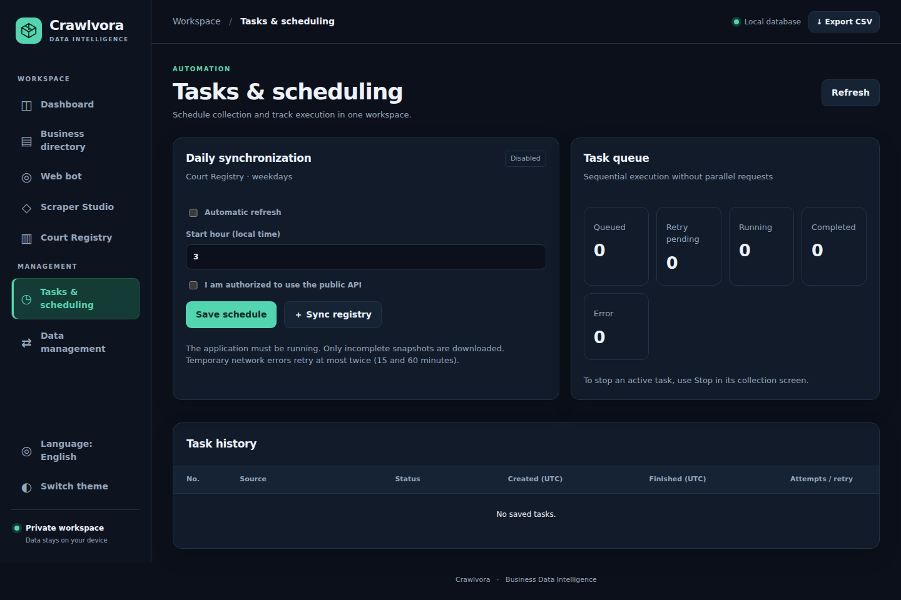
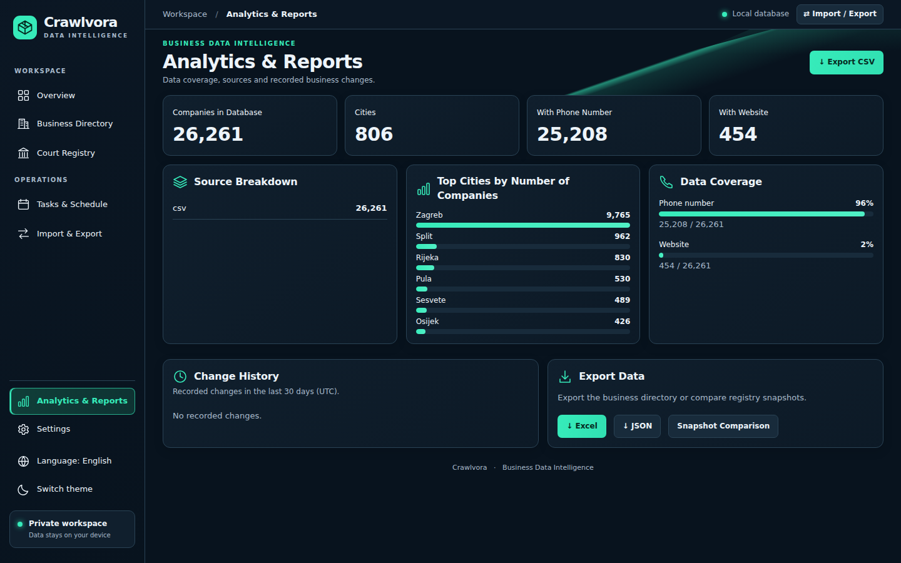
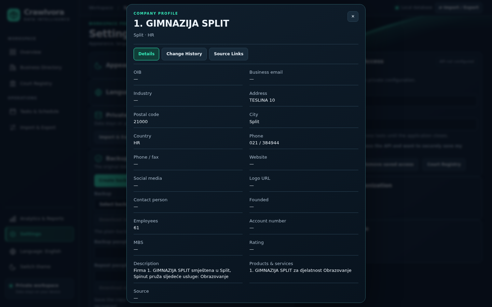
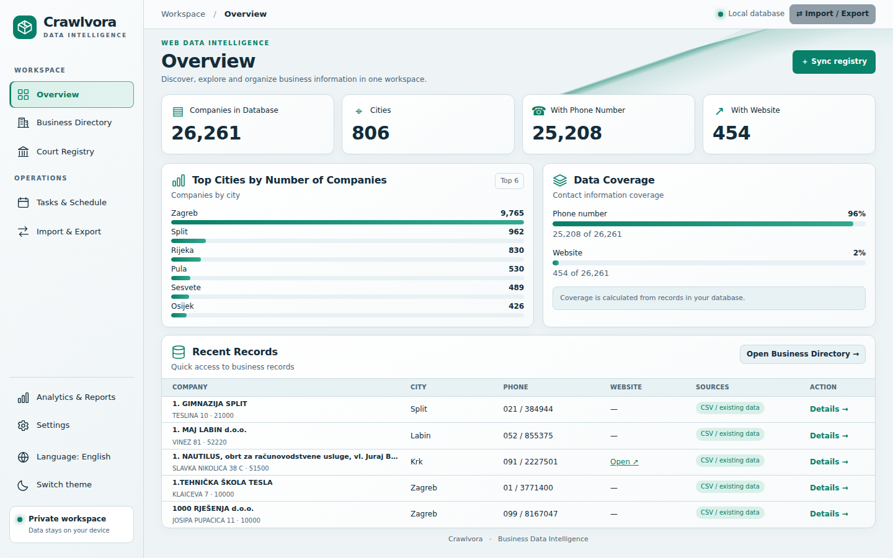

# Crawlvora

### Business intelligence. On your terms.

Explore official business registers, discover company information and turn local data into useful insights — in one carefully designed desktop workspace.

**[Explore releases](https://github.com/bren-wp/Crawlvore/releases)** · [Discover the workspace](#explore-the-workspace) · [User guide](docs/USER-GUIDE.md)

---

## Make business data useful

| | |
|---|---|
| 🏢 **Business Directory** | Search by name, location, OIB or MBS; filter records and explore company profiles. |
| 🇭🇷 **Crawlvora Sync** | Synchronize authorized Croatian Court Registry records, resume interrupted downloads and preserve source provenance. |
| 🇬🇧 **Crawlvora UK** | Search the separate Companies House monthly catalog when installed locally. |
| 🔑 **Crawlvora Connect** | Manage authorized registry access with operating-system-protected credential storage. |
| 📊 **Analytics & Reports** | Understand available data and export structured reports. |
| 🗓️ **Tasks & Schedule** | Manage synchronization tasks and scheduled updates while the application is running. |
| 📥 **Import & Export** | Import CSV or JSON; export directory records to CSV, JSON or Excel and registry categories to additional formats. |
| 🛡️ **Data protection** | Keep your working database local, create verified backups and recover into a separate workspace. |

## Explore the workspace

<!-- PRODUCT_SCREENSHOTS_START -->
The following interface captures are existing English browser fixture views; they are not native Windows screenshots or evidence of current visual acceptance.

| Overview | Business Directory |
|---|---|
|  |  |

| Crawlvora Sync | Tasks & Schedule |
|---|---|
|  |  |

| Import & Export | Analytics & Reports |
|---|---|
|  |  |

| Settings | Company Profile |
|---|---|
|  |  |

<!-- PRODUCT_SCREENSHOTS_END -->

Choose English or Croatian and dark or light appearance. Resize the desktop window to fit your workspace.

## Choose your edition

The intended Windows distribution offers four editions. Availability depends on verified release assets and approved data distribution.

| Edition | Included national catalogs |
|---|---|
| Full | Croatia + United Kingdom |
| HR | Croatia |
| GB | United Kingdom |
| Online | None; connect or use compatible existing local catalogs |

## Get Crawlvora

[**Browse published releases**](https://github.com/bren-wp/Crawlvore/releases)

| Platform | Package |
|---|---|
| Windows 10/11 x64 | Portable executable or installer |
| Linux x86_64 | DEB package or TAR.GZ distribution |

The current 8.1.4 public download is a non-production candidate. Check the release notes and accompanying manifest before use; it does not contain a verified complete national catalog. Windows packages may be unsigned. Production editions must pass their respective acceptance checks before distribution.

## Crawlvora for the web

🌐 **Crawlvora Web** provides a shared-hosting PHP business directory for approved catalog data.

🧩 **WordPress Business Directory** integrates approved catalog search and company profiles into WordPress. These components are separately packaged when verified; availability is determined by the release assets.

## Your data stays yours

Crawlvora keeps local workspaces on your device. Authorized registry access requires valid credentials; secure storage uses Windows DPAPI or Linux Secret Service when available. Coverage and data freshness depend on the installed snapshot and synchronization status. Crawlvora is independent of the Croatian Court Registry and Companies House.

[Croatian Court Registry](https://sudreg-data.gov.hr/) · [Companies House data](https://download.companieshouse.gov.uk/en_output.html) · [User guide](docs/USER-GUIDE.md) · [License](LICENSE)

---

**Crawlvora — Business Data Intelligence**

[Releases](https://github.com/bren-wp/Crawlvore/releases) · [Support](https://github.com/bren-wp/Crawlvore/issues)

