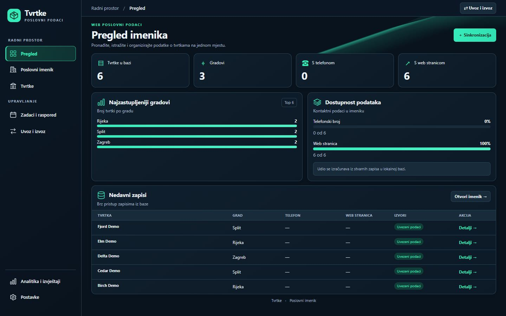
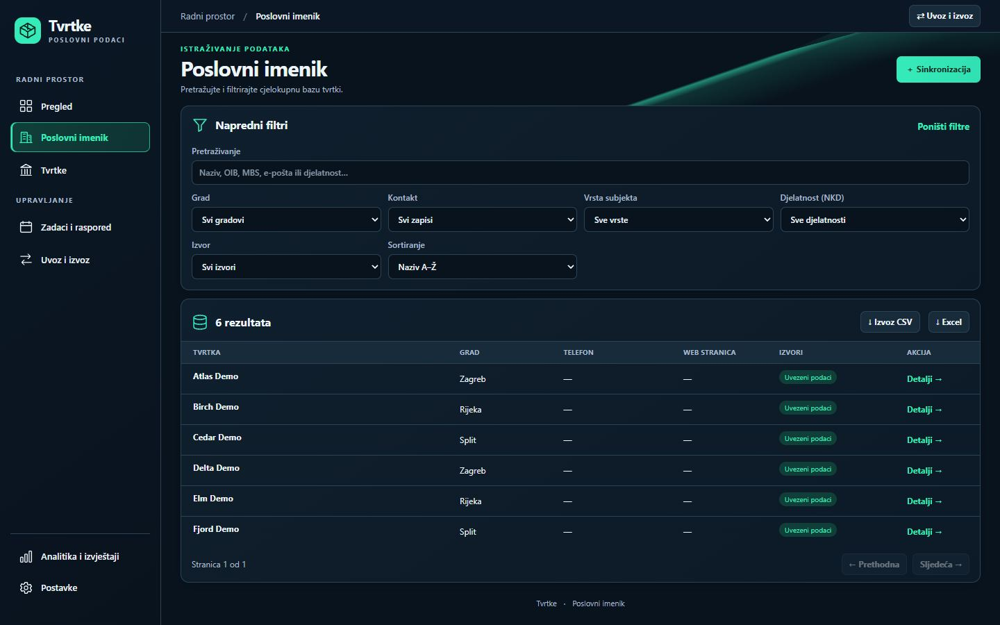
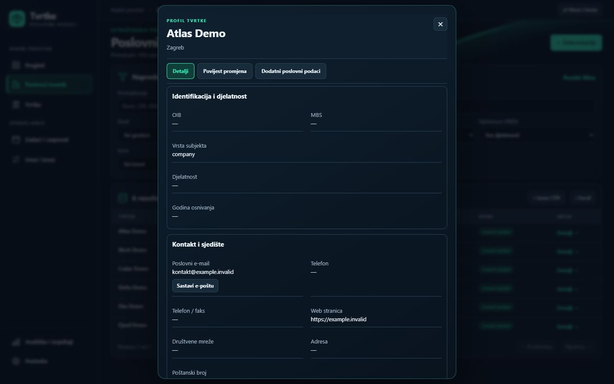
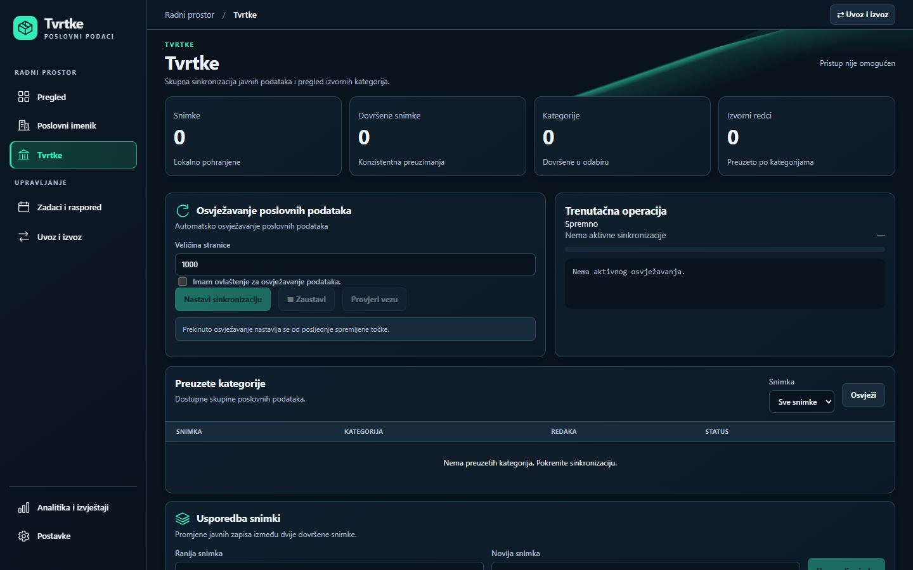
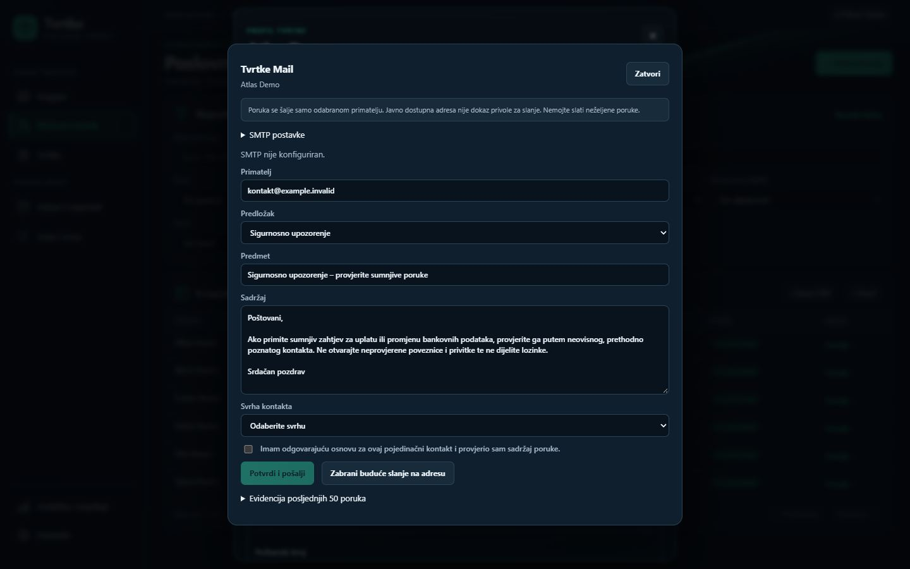
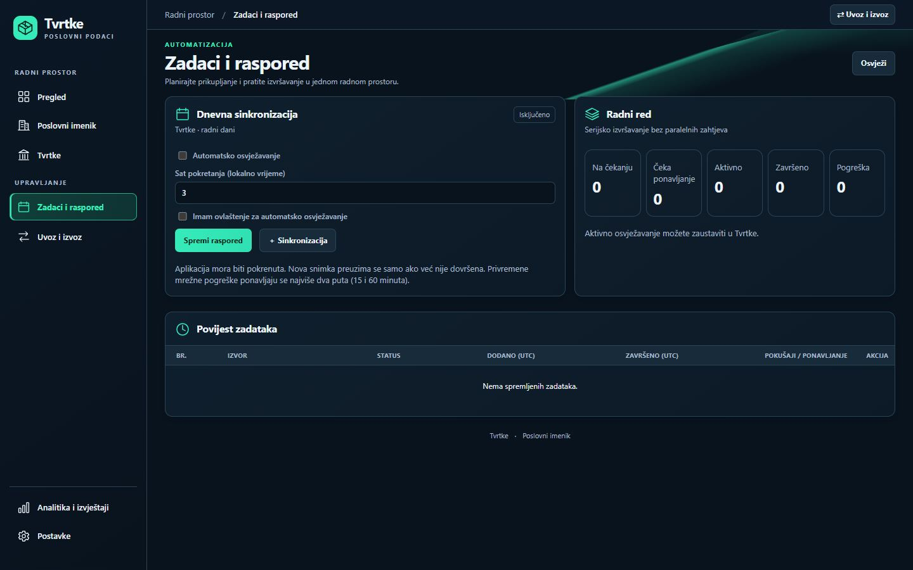
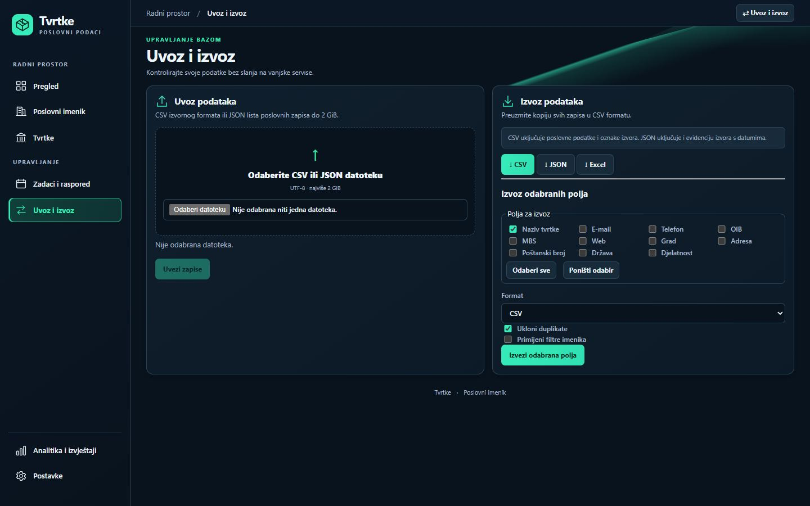
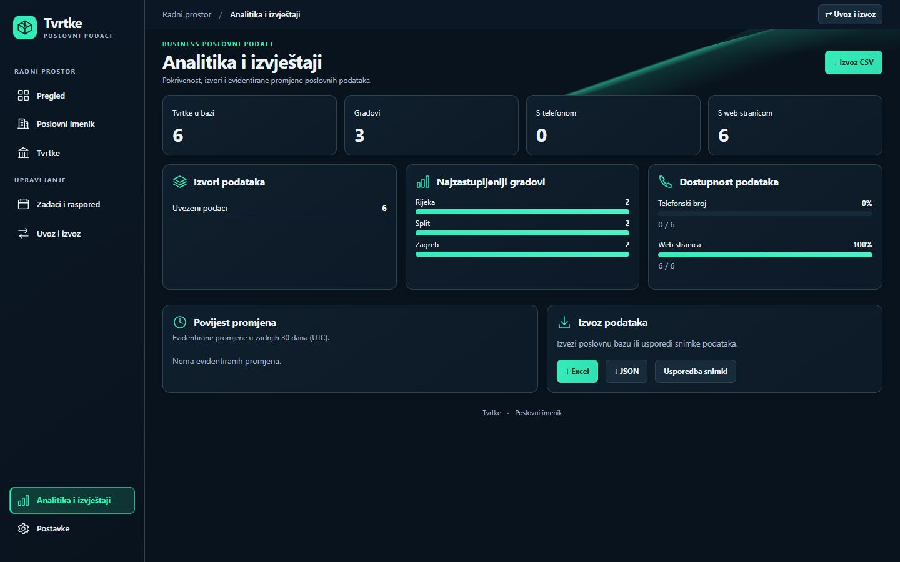
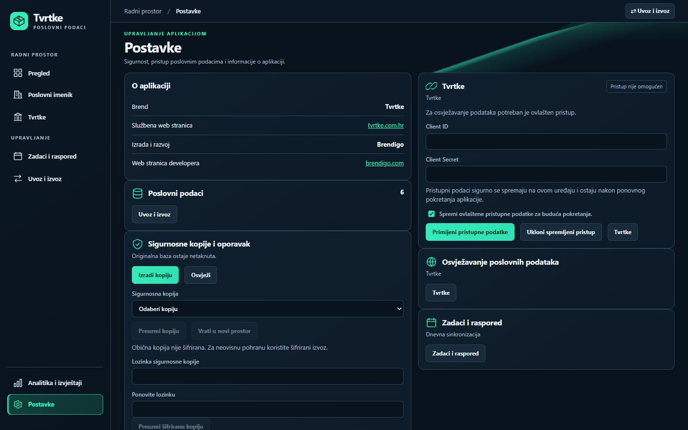

# Tvrtke

### Poslovni podaci. Na jednom mjestu.

Istražite poslovne subjekte, pronađite relevantne informacije i organizirajte poslovne podatke.

**[Explore releases](https://github.com/bren-wp/Crawlvore/releases)** · [Discover the workspace](#explore-the-workspace) · [User guide](docs/USER-GUIDE.md)

**[tvrtke.com.hr](https://tvrtke.com.hr/)** · Izrada i razvoj: **[Brendigo](https://brendigo.com/)**

---

## Make business data useful

| | |
|---|---|
| 🏢 **Business Directory** | Search by name, location, OIB or MBS; filter records and explore company profiles. |
| 🇭🇷 **Tvrtke** | Synchronize authorized Croatian Court Registry records, resume interrupted downloads and preserve source provenance. |
| 🔑 **Tvrtke** | Manage authorized registry access with operating-system-protected credential storage. |
| 📊 **Analytics & Reports** | Understand available data and export structured reports. |
| 🗓️ **Tasks & Schedule** | Manage synchronization tasks and scheduled updates while the application is running. |
| 📥 **Import & Export** | Import CSV or JSON; export directory records to CSV, JSON or Excel and registry categories to additional formats. |
| 🛡️ **Data protection** | Keep your working database local, create verified backups and recover into a separate workspace. |
| ✉️ **Tvrtke Mail** | Compose individual correspondence and security notices from a company profile, using your own TLS SMTP account. [Mail guide](docs/MAIL.md). |

## Explore the workspace

<!-- PRODUCT_SCREENSHOTS_START -->
Actual desktop application interface, captured from a disposable synthetic workspace.

| Business Directory | Company Profile |
|---|---|
|  |  |

| Tasks & Schedule | Import & Export |
|---|---|
|  |  |

| Analytics & Reports | Settings |
|---|---|
|  |  |

<!-- PRODUCT_SCREENSHOTS_END -->

Hrvatsko sučelje s jedinstvenom tamnom temom.

## Choose your edition

Two Croatian editions are built for Windows and Linux.

| Edition | Included data |
|---|---|
| HR Full | Verified Croatian Court Registry snapshot |
| HR Online | Empty workspace on first launch |

The interface is exclusively Croatian with a fixed dark appearance. Existing user databases are preserved during upgrades. Full distribution uses only the verified Croatian data archive and never embeds API credentials.

## Get Tvrtke

[**Browse published releases**](https://github.com/bren-wp/Crawlvore/releases)

| Platform | Package |
|---|---|
| Windows 10/11 x64 | Portable executable or installer |
| Linux x86_64 | DEB package or TAR.GZ distribution |

Check the release manifest and SHA-256 checksums before installing. Windows packages may be unsigned.

## Your data stays yours

Tvrtke keeps local workspaces on your device. Authorized registry access requires valid credentials; secure storage uses Windows DPAPI or Linux Secret Service when available. Coverage and data freshness depend on the installed snapshot and synchronization status. Tvrtke is independent of the Croatian Court Registry.

---

**Tvrtke — Business Data Intelligence**

[Releases](https://github.com/bren-wp/Crawlvore/releases) · [Support](https://github.com/bren-wp/Crawlvore/issues)

